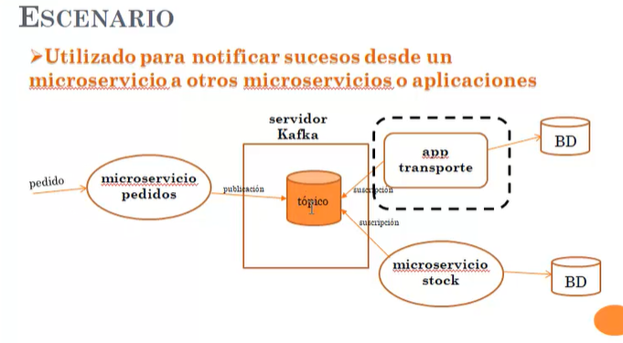

# 📦 Proyecto de manejo de ordenes de productos

Este proyecto  contiene 1 productor de mesnajes enviados a Kafka y tiene 2 consumidores que actualiza el stock y resgitar que se debe enviar en transporte el producto

---

## 🚀 Tecnologías y herramientas

- Java 21
- Spring Boot 4.x
- R2DBC reactivo con mysql
- Maven 
- Base de datos: Mysql 
- Otros: KAFKA

---

## 🧩 Arquitectura

Describe brevemente la estructura del proyecto:
- `controller/`: Exposición de endpoints con funtional endpoints y no con @REST
- `service/`: Lógica de negocio
- `repo/`: Acceso a datos con R2DBC q no es lo mismo que JPA
- `model/`: Mapeo de entidades R2DBC q no es lo mismo que JPA
- `config/`: Configuraciones generales (mappers.)

---

## 🧪 Revisar los readme de cada proyecto, se encuentran las intrucciones claras de como levantar los proyectos

## 🧪 Instalación de kafka:
- Descargar Binary download Kafka de la página: https://kafka.apache.org/community/downloads/
- Descomprimir donse se desee e ingrasar hasta donde pueda ver la carpeta bin (no dentro de bin)
- Ejecutar los comandos:
1. bin\windows\kafka-storage ramdom-uuid: se genero--> Uboc-Zn9RfG7QO_2b1Fedg         -----> crea un identificador del cluster (reemplazar el que te generó en la líena de abajo)
2. bin\windows\kafka-storage format --standalone -t uuidcluster -c config\server.properties---> bin\windows\kafka-storage format --standalone -t Uboc-Zn9RfG7QO_2b1Fedg -c config\server.properties
3. set KAFKA_HEAP_OPTS=-Xmx1G -Xms1G
4. bin\windows\kafka-server-start config\server.properties  ----->inicia kafka
6. bin\windows\kafka-topics --list --bootstrap-server localhost:9092   ------> listar los topicos para esto abrir otra ventana y dejar la que levanto Kafka 
7. ver los readme de los proyectos y segir las instruccon de como levantar un docker de kafdrop y con eso puedo tener una GUI para ver los mensaje en kafka

8. Si no te levanta revisar los errores paar validar ya que para ver desde docker el kafka q no está en la red de docker deben haecese cambios en : X:\xx\xx\kafka_2.13-4.3.1\config
    - en el file server.properties reemplazar las siguientes líneas:
    listeners=PLAINTEXT://0.0.0.0:9092,CONTROLLER://0.0.0.0:9093
    advertised.listeners=PLAINTEXT://host.docker.internal:9092,CONTROLLER://host.docker.internal:9093

9. sí fue el caso de reemplzar, volver a ejecutar toso de nuevo pero borrando la carpeta x:\tmp\kraft-combined-logs que se generó

